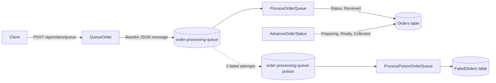

# CoffeeNChill — Canteen Management System

**Part 2 — Queue Triggers & Docker Compose Orchestration**

CoffeeNChill is a campus canteen. Part 1 replaced the paper menus and filing-cabinet documents with Azure Table Storage, Azure Blob Storage and HTTP-triggered Azure Functions. Part 2 handles the lecture-break rush:

- **Azure Storage Queue** (`order-processing-queue`) so students never wait while an order is being prepared.
- **Queue-triggered Azure Function** that logs each order in the **Orders** table.
- **Timer-triggered Azure Function** that moves every order through the barista lifecycle.
- **Poison queue handling** that records failed messages in the **FailedOrders** table.
- **Docker Compose** that starts Azurite and the Functions app with one command, using images pulled from Docker Hub.

---

## How an order flows



1. `QueueOrder` validates the order, fills in `OrderId` and `OrderTimestamp` when they are missing, and places the JSON message on `order-processing-queue`. The client gets `202 Accepted` straight away.
2. `ProcessOrderQueue` fires as soon as the message arrives, parses it and writes a row to the `Orders` table with `PartitionKey` = order date (`yyyy-MM-dd`), `RowKey` = `OrderId` and `Status` = `Received`.
3. `AdvanceOrderStatus` runs every 5 seconds and moves each active order one step forward after it has spent 10 seconds in its current status: `Received` → `Preparing` → `Ready` → `Collected`.
4. If a message cannot be processed it is retried, and after 3 failed attempts the Functions host moves it to `order-processing-queue-poison`. `ProcessPoisonOrderQueue` stores it in the `FailedOrders` table with the payload, the reason and the dequeue count.

Messages are sent with Base64 encoding and decoded again by the queue trigger (`messageEncoding` is set to `base64` in `host.json`).

---

## Project structure

```
CoffeeNChill/
├── .gitattributes
├── .gitignore
├── CoffeeNChill.slnx
├── README.md
├── docker-compose.yml
├── docs/
│   └── CoffeeNChill.postman_collection.json
└── CoffeeNChillExample/
    ├── .dockerignore
    ├── .gitignore
    ├── CoffeeNChill.csproj
    ├── Dockerfile
    ├── host.json
    ├── local.settings.json
    ├── Program.cs
    ├── Functions/
    │   ├── AdvanceOrderStatus.cs
    │   ├── CreateMenuItem.cs
    │   ├── DeleteMenuItem.cs
    │   ├── DownloadStaffDocument.cs
    │   ├── GetAllMenuItems.cs
    │   ├── GetAllOrders.cs
    │   ├── GetFailedOrders.cs
    │   ├── GetMenuItemsByCategory.cs
    │   ├── GetOrderById.cs
    │   ├── ListStaffDocuments.cs
    │   ├── ProcessOrderQueue.cs
    │   ├── ProcessPoisonOrderQueue.cs
    │   ├── QueueOrder.cs
    │   ├── UpdateMenuItem.cs
    │   └── UploadStaffDocument.cs
    ├── Models/
    │   ├── FailedOrderEntity.cs
    │   ├── MenuItem.cs
    │   ├── OrderEntity.cs
    │   ├── OrderQueueMessage.cs
    │   └── StaffDocument.cs
    ├── Properties/
    │   ├── launchSettings.json
    │   ├── serviceDependencies.json
    │   └── serviceDependencies.local.json
    └── Services/
        ├── BlobService.cs
        ├── FailedOrderService.cs
        ├── OrderService.cs
        ├── QueueService.cs
        └── TableService.cs
```

---

## API Endpoints

### Menu Items (Part 1)

| Method | Route                           | Description                              |
|--------|---------------------------------|------------------------------------------|
| POST   | `/api/menu`                     | Create a new menu item                   |
| GET    | `/api/menu`                     | Get all menu items                       |
| GET    | `/api/menu/category/{category}` | Get menu items filtered by category      |
| PUT    | `/api/menu/{category}/{id}`     | Update a menu item's price/availability  |
| DELETE | `/api/menu/{category}/{id}`     | Delete a menu item                       |

### Staff Documents (Part 1)

| Method | Route                                | Description                                  |
|--------|--------------------------------------|----------------------------------------------|
| POST   | `/api/documents/upload`              | Upload a file                                |
| GET    | `/api/documents`                     | List all files (name, size, last modified)   |
| GET    | `/api/documents/download/{fileName}` | Download a file by name                      |

### Orders (Part 2)

| Method | Route                  | Description                                                   |
|--------|------------------------|---------------------------------------------------------------|
| POST   | `/api/orders/queue`    | Validate an order and place it on `order-processing-queue`    |
| GET    | `/api/orders`          | Get every order in the `Orders` table                         |
| GET    | `/api/orders/{orderId}`| Get one order and its current status                          |
| GET    | `/api/failed-orders`   | Get the messages that ended up in the poison queue            |

Background functions (no route): `ProcessOrderQueue` (queue trigger), `ProcessPoisonOrderQueue` (queue trigger on the poison queue) and `AdvanceOrderStatus` (timer trigger).

### Order message

```json
{
    "OrderId": "ORD-2026-8801",
    "CustomerName": "Jane Smith",
    "SelectedItemSKUs": ["COF-001", "PAS-104"],
    "TotalPrice": 65.00,
    "OrderTimestamp": "2026-10-12T10:15:00Z"
}
```

`CustomerName`, at least one SKU and a `TotalPrice` greater than zero are required. `OrderId` and `OrderTimestamp` are generated when they are left out.

| Response | Meaning |
|----------|---------|
| `202 Accepted` | The order was validated and placed on the queue |
| `400 Bad Request` | Malformed JSON or a failed validation rule |
| `503 Service Unavailable` | The order queue could not be reached |
| `500 Internal Server Error` | Any other error |

---

## Prerequisites

- Visual Studio 2022 (or later) with the **Azure development** workload
- Docker Desktop (running)
- Postman
- Azure Storage Explorer (optional, to look inside the queues and tables)

Azurite ports: `10000` Blob, `10001` Queue, `10002` Table.

## Running the whole stack with Docker Compose

This pulls both images from Docker Hub and starts them with a single command from the repository root.

```bash
docker compose up
```

(`docker-compose up` works the same on older Docker installs.)

The Functions app is then available on `http://localhost:7071`. Azurite keeps its data in the `azurite_data` volume, so queues, tables and blobs survive restarts.

```bash
docker compose down
docker compose down -v
```

The first command stops the stack and keeps the data. The second also deletes the Azurite volume.

Before using the compose file, replace `<dockerhub_username>` in `docker-compose.yml` with your Docker Hub username.

## Running locally from Visual Studio

### 1. Start Azurite in Docker

```bash
docker run -d --name azurite -p 10000:10000 -p 10001:10001 -p 10002:10002 mcr.microsoft.com/azure-storage/azurite
```

### 2. Run the Function App

1. Open `CoffeeNChill.slnx`.
2. Press `F5` (or click the green **Start** button).
3. Note the local URL printed in the console (default `http://localhost:7071`).

`local.settings.json` points `AzureWebJobsStorage` at Azurite (`UseDevelopmentStorage=true`). When the app starts it creates the `MenuItems`, `Orders` and `FailedOrders` tables, the `staff-docs` blob container and the `order-processing-queue` queue if they do not exist yet.

## Docker Hub images

### Azurite (unchanged from Part 1)

```bash
docker pull mcr.microsoft.com/azure-storage/azurite:latest
docker tag mcr.microsoft.com/azure-storage/azurite:latest <dockerhub_username>/coffeenchill-azurite:v1.0
docker push <dockerhub_username>/coffeenchill-azurite:v1.0
```

### Functions app (v2.0)

Run these from the repository root.

```bash
cd CoffeeNChillExample
docker build -t <dockerhub_username>/coffeenchill-functions:v2.0 .
docker push <dockerhub_username>/coffeenchill-functions:v2.0
```

Docker Hub images:
- Functions: `https://hub.docker.com/r/<dockerhub_username>/coffeenchill-functions`
- Azurite: `https://hub.docker.com/r/<dockerhub_username>/coffeenchill-azurite`

### Running the containers individually

```bash
docker run -d --name azurite -p 10000:10000 -p 10001:10001 -p 10002:10002 <dockerhub_username>/coffeenchill-azurite:v1.0
docker run -d --name coffeenchill-functions -p 7071:80 -e AzureWebJobsStorage="DefaultEndpointsProtocol=http;AccountName=devstoreaccount1;AccountKey=Eby8vdM02xNOcqFlqUwJPLlmEtlCDXJ1OUzFT50uSRZ6IFsuFq2UVErCz4I6tq/K1SZFPTOtr/KBHBeksoGMGw==;BlobEndpoint=http://host.docker.internal:10000/devstoreaccount1;QueueEndpoint=http://host.docker.internal:10001/devstoreaccount1;TableEndpoint=http://host.docker.internal:10002/devstoreaccount1;" <dockerhub_username>/coffeenchill-functions:v2.0
```

Inside Docker Compose the storage endpoints use the service name (`azurite`) instead of `host.docker.internal`.

## Testing with Postman

1. Import `docs/CoffeeNChill.postman_collection.json` into Postman.
2. Confirm the collection variable `baseUrl` matches your Functions URL (`http://localhost:7071/api` by default).
3. Run the **Menu Items**, **Staff Documents** and **Orders** folders in that order.

The **Orders** folder:

| Request | What it proves |
|---------|----------------|
| Place Order | A valid order is accepted and placed on the queue (a new `OrderId` is generated for each run) |
| Place Order (Generated ID and Timestamp) | `OrderId` and `OrderTimestamp` are generated when missing |
| Place Order (Missing Customer Name / No Items / Invalid Total Price / Invalid Order ID / Malformed JSON) | Every validation rule returns `400` and nothing is queued |
| Get All Orders | The queue function wrote the order into the `Orders` table |
| Get Order By Id (Received) | The order was logged with status `Received` |
| Get Order By Id (Generated ID) | The order that had no `OrderId` was processed |
| Get Order By Id (Not Found) | An unknown order returns `404` |
| Get Order Status (Preparing / Ready) | The timer function moved the order forward |
| Get Order Status (Collected) | The order completed the full lifecycle |
| Place Duplicate Order (Poison Queue) | Re-sending an existing `OrderId` is accepted by the producer |
| Get Failed Orders | The duplicate was retried, moved to the poison queue and logged in `FailedOrders` |

Some requests wait 4 to 30 seconds before they send so the queue and timer functions have time to run, so the full Orders folder takes just over a minute.

### Looking inside the queue and tables

In Azure Storage Explorer open **Emulator & Attached → (Emulator - Default Ports) → Storage Accounts → Queues / Tables**. Right after an order is placed you can see the message in `order-processing-queue`, then the row in `Orders` and its `Status` changing every 10 seconds or so.

### Demonstrating the poison queue

Either send the duplicate order from the Postman collection, or add a broken message by hand: in Storage Explorer open `order-processing-queue`, choose **Add Message**, tick **Encode message body in Base64** and enter text that is not valid JSON, for example `not an order`. After 3 failed attempts the message appears in `order-processing-queue-poison` and a row appears in the `FailedOrders` table (also visible through `GET /api/failed-orders`).

---

## Changelog

### v2.0 — Part 2: Queue Triggers & Docker Compose

**Added**
- `QueueOrder` (`POST /api/orders/queue`): validates the order, generates `OrderId` and `OrderTimestamp` when missing, serializes it to JSON and places it on `order-processing-queue` using Base64 encoding. Returns `202`, `400`, `503` or `500`.
- `ProcessOrderQueue`: queue trigger that parses the message and writes it to the `Orders` table with status `Received`. Errors are logged and rethrown so the host retries and then poisons the message.
- `AdvanceOrderStatus`: timer trigger (every 5 seconds) that moves orders `Received` → `Preparing` → `Ready` → `Collected`.
- `ProcessPoisonOrderQueue`: queue trigger on `order-processing-queue-poison` that records failed messages in the `FailedOrders` table.
- `GetAllOrders`, `GetOrderById` and `GetFailedOrders` so order status and failures can be checked from Postman.
- `OrderQueueMessage`, `OrderEntity` and `FailedOrderEntity` models and `QueueService`, `OrderService` and `FailedOrderService` services.
- `docker-compose.yml`: Azurite and the Functions app from Docker Hub images (`coffeenchill-azurite:v1.0`, `coffeenchill-functions:v2.0`), a custom bridge network and a volume for Azurite data.
- Queue settings in `host.json` (2 second polling, 3 attempts before poison, Base64 messages).
- Postman collection updated with an **Orders** folder covering every new function.

**Changed**
- The storage services are now created once at startup in `Program.cs` from the `AzureWebJobsStorage` setting instead of using a hard-coded `UseDevelopmentStorage=true` in every function. The same code now runs from Visual Studio and from Docker Compose, where Azurite is reached at `azurite` instead of `localhost`.
- The existing menu and document functions receive their service through constructor injection.
- The menu table is named `MenuItems` to match the brief (it was `Menuitems`).
- `CoffeeNChill.slnx` points at `CoffeeNChillExample/CoffeeNChill.csproj`, and the empty `CoffeeNChill/` project was removed.
- Added `Azure.Storage.Queues`, `Microsoft.Azure.Functions.Worker.Extensions.Storage.Queues` and `Microsoft.Azure.Functions.Worker.Extensions.Timer`.

**Fixed**
- Removed the inline comment on the Dockerfile `FROM` line, which Docker reads as extra arguments.
- Corrected the Docker Hub image names in the push commands.

### v1.0 — Part 1: Azure Functions, Tables, Blob Storage & Docker Hub

- Menu item CRUD functions on Azure Table Storage.
- Staff document upload, list and download functions on Azure Blob Storage.
- Azurite in Docker, Dockerfile for the Functions app and the Postman collection for Part 1.

---

## Team Contributions

### Part 1

| Member | Student Number | Contribution |
|---|---|---|
| Jake Jacobs | [Number] | Set up the functions that let users add, view, update and delete menu items using Table Storage, made the menu and staff document models, and built the code that connects to Table Storage. Also got file uploads for staff documents working, using Azure File Shares. |
| Liyema Mncora | st10397155 | Swapped the file storage over to Azure Blob Storage like the brief asked for, fixed the file upload code so it properly handles real file uploads instead of just a filename trick and made the storage setup safer by loading it properly instead of blocking the app while it starts. |

### Part 2

| Member | Student Number | Contribution |
|---|---|---|
| Jake Jacobs | [Number] | [Part 2 contribution] |
| Liyema Mncora | st10397155 | [Part 2 contribution] |

## Video Demonstration

- Part 1: [Youtube Demo](https://youtu.be/oURz118OSBA): https://youtu.be/oURz118OSBA
- Part 2: [Part 2 video link]

## References

Microsoft (2026a) _Azure Functions documentation_. Available at: https://learn.microsoft.com/en-us/azure/azure-functions/ (Accessed: 13 September 2026).

Microsoft (2026b) _Guide for running C# Azure Functions in the isolated worker model_. Available at: https://learn.microsoft.com/en-us/azure/azure-functions/dotnet-isolated-process-guide (Accessed: 13 September 2026).

Microsoft (2026c) _Azure Functions HTTP trigger_. Available at: https://learn.microsoft.com/en-us/azure/azure-functions/functions-bindings-http-webhook-trigger (Accessed: 13 September 2026).

Microsoft (2026d) _What is Azure Table storage?_. Available at: https://learn.microsoft.com/en-us/azure/storage/tables/table-storage-overview (Accessed: 13 September 2026).

Microsoft (2026e) _Azure Blob storage documentation_. Available at: https://learn.microsoft.com/en-us/azure/storage/blobs/ (Accessed: 13 September 2026).

Microsoft (2026f) _Use Azurite emulator for local Azure Storage development_. Available at: https://learn.microsoft.com/en-us/azure/storage/common/storage-use-azurite (Accessed: 13 September 2026).

Microsoft (2026g) _Azure Tables client library for .NET - version 12.12.0_. Available at: https://learn.microsoft.com/en-us/dotnet/api/overview/azure/data.tables-readme (Accessed: 13 September 2026).

Microsoft (2026h) _Azure Storage Blobs client library for .NET - version 12.29.2_. Available at: https://learn.microsoft.com/en-us/dotnet/api/overview/azure/storage.blobs-readme (Accessed: 13 September 2026).

Microsoft (2026i) _Upload files in ASP.NET Core_. Available at: https://learn.microsoft.com/en-us/aspnet/core/mvc/models/file-uploads (Accessed: 13 September 2026).

W3Schools (2026a) _C# Files_. Available at: https://www.w3schools.com/cs/cs_files.php (Accessed: 13 September 2026).

W3Schools (2026b) _JavaScript JSON_. Available at: https://www.w3schools.com/js/js_json.asp (Accessed: 13 September 2026).

Docker Inc. (2026) _Docker Manuals_. Available at: https://docs.docker.com/manuals/ (Accessed: 13 September 2026).

Postman Inc. (2026) _Get started in Postman_. Available at: https://learning.postman.com/docs/getting-started/overview/ (Accessed: 13 September 2026).

Microsoft (2026j) TableClient.UpdateEntity<T> Method (Azure.Data.Tables). Available at: https://learn.microsoft.com/en-us/dotnet/api/azure.data.tables.tableclient.updateentity (Accessed: 14 September 2026).

Microsoft (2026k) BlobBaseClient.DownloadStreamingAsync Method (Azure.Storage.Blobs). Available at: https://learn.microsoft.com/en-us/dotnet/api/azure.storage.blobs.specialized.blobbaseclient.downloadstreamingasync (Accessed: 14 September 2026).

Microsoft (2026l) Differences between the isolated worker model and the in-process model for .NET on Azure Functions. Available at: https://learn.microsoft.com/en-us/azure/azure-functions/dotnet-isolated-in-process-differences (Accessed: 14 September 2026).

Microsoft (2026m) Use OpenTelemetry with Azure Functions. Available at: https://learn.microsoft.com/en-us/azure/azure-functions/opentelemetry-howto (Accessed: 14 September 2026).

Mrzyglod, K. (2022) Azure for Developers: Implement rich Azure PaaS ecosystems using containers, serverless services, and storage solutions. 2nd edn. Birmingham: Packt Publishing. ISBN: 9781803240091.

Huawei (2022) Cloud Computing Technology. Singapore: Springer. ISBN: 978-981-19-3025-6. Available at: https://link.springer.com/book/10.1007/978-981-19-3026-3 (Accessed: 12 September 2026).

IIE (2026) Cloud Development B: Lecture notes distributed in CLDV6212 Learning Unit 1. Available at: https://mystudies.iie.edu.za/d2l/le/lessons/81852/units/5622998 (Accessed: 14 September 2026).

IIE (2026) Cloud Development B: Lecture notes distributed in CLDV6212 Learning Unit 2. Available at: https://mystudies.iie.edu.za/d2l/le/lessons/81852/units/5622999 (Accessed: 14 September 2026).

IIE (2026) Cloud Development B: Lecture notes distributed in CLDV6212 Learning Unit 3. Available at: https://mystudies.iie.edu.za/d2l/le/lessons/81852/units/5623000 (Accessed: 14 September 2026).
